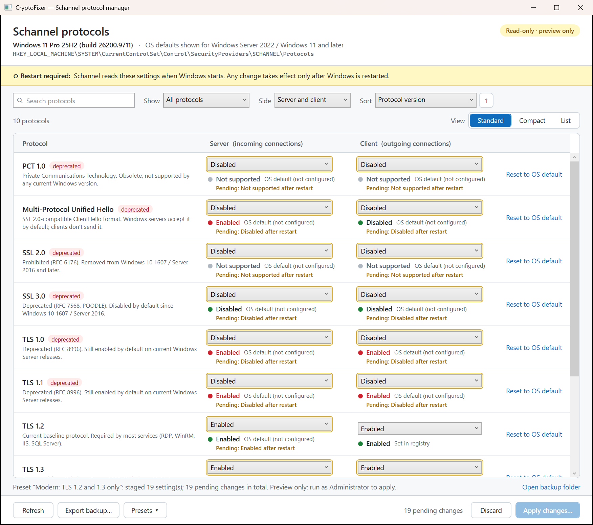
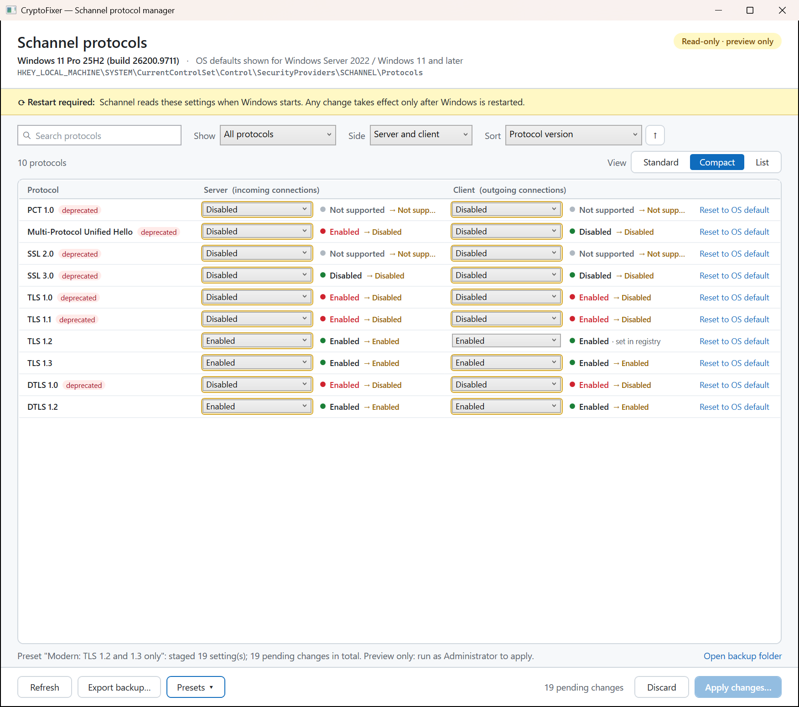
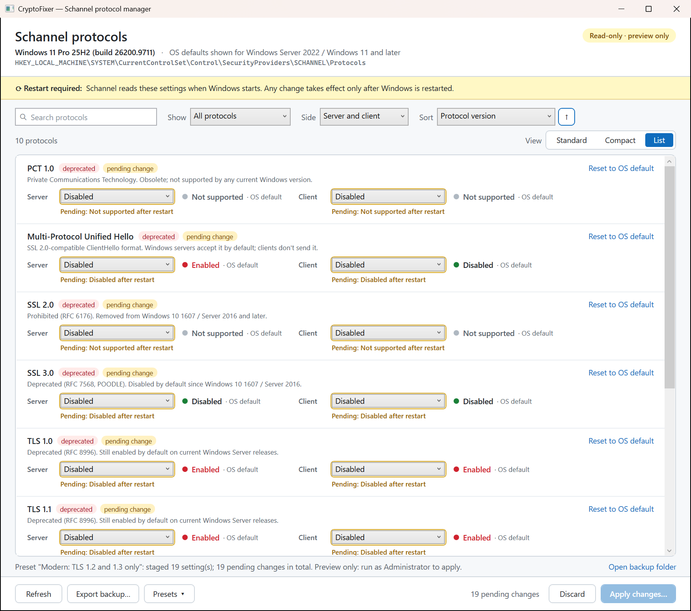

# CryptoFixer

CryptoFixer is a Windows desktop app (WPF) that shows which **Schannel security protocols** are enabled on a Windows Server or Windows machine and lets you enable or disable them per role (**Server** and **Client**).

It manages the standard Schannel registry settings:

```
HKLM\SYSTEM\CurrentControlSet\Control\SecurityProviders\SCHANNEL\Protocols\<Protocol>\{Server|Client}
    Enabled            (DWORD)
    DisabledByDefault  (DWORD)
```

Protocols covered: PCT 1.0, Multi-Protocol Unified Hello, SSL 2.0, SSL 3.0, TLS 1.0, TLS 1.1, TLS 1.2, TLS 1.3, DTLS 1.0, DTLS 1.2.



| Compact view | List view |
|---|---|
|  |  |

## Requirements

- Windows Server 2016 or later, or Windows 10/11. Older builds also work, and their OS defaults are shown.
- **Administrator rights** to make changes. The executable asks for elevation (UAC). Without elevation it opens **read-only**.
- **A restart is required** before Schannel protocol changes take effect.
- No installer and no .NET runtime: the release is one self-contained `CryptoFixer.exe` (see [Installing on a server](#installing-on-a-server)).
- To build: the .NET 10 SDK. Self-contained builds don't need a .NET runtime on the server.

## Using the app

Each protocol has a **Server** and a **Client** cell. Each cell shows:

- **Setting** (drop-down):
  - `OS default (…)`: no registry values, so Windows uses its built-in default for this build (shown in brackets).
  - `Enabled`: writes `Enabled=1`, `DisabledByDefault=0`.
  - `Disabled`: writes `Enabled=0`, `DisabledByDefault=1`.
  - `Custom (keep current values)`: appears only when the registry already holds a combination this app doesn't write, such as `Enabled=1` with `DisabledByDefault=1`. The app leaves those values unchanged.
- **Effective state**: what Schannel actually uses. It is one of *Enabled*, *Enabled (on request only)* (meaning `DisabledByDefault=1`, so only apps that explicitly ask for the protocol can use it), *Disabled*, or *Not supported* on this Windows build (any registry values are ignored).
- **Source**: either *Set in registry* or *OS default (not configured)*. Hover over a cell to see the raw registry values.

### Workflow

1. Change the drop-downs. Changes are **staged** (highlighted) and nothing is written yet.
2. Click **Apply changes…**. A confirmation lists every change and shows warnings, for example:
   - no TLS 1.2/1.3 would be left for a role, which breaks RDP, WinRM and HTTPS
   - you are enabling a deprecated or unsupported protocol
   - you are disabling TLS 1.0/1.1 that is still in use
3. Before writing, the app **automatically saves a `.reg` backup** of the whole `Protocols` tree to `Documents\CryptoFixer\Backups\Schannel-Protocols-<machine>-<timestamp>.reg`. If the backup fails, nothing is applied.
4. **Restart Windows** for the changes to take effect. The app offers to restart (with a 10-second delay) or you can restart later.

Other actions:

- **Reset to OS default** (per row): removes `Enabled` and `DisabledByDefault` for both roles.
- **Presets ▾**: stages a built-in or saved configuration (see [Presets](#presets)).
- **Export backup…**: saves a `.reg` backup on demand.
- **Discard**: drops all staged changes.

### Search, filter and sort

The toolbar above the table narrows and orders the protocol list. Filters only change what is shown: staged changes stay staged when their rows are hidden, and **Apply** always applies all of them.

- **Search** (Ctrl+F): matches protocol names and descriptions. It ignores case and spaces, so `tls1.2` finds TLS 1.2. With several words, all of them must match. Esc clears the search.
- **Show**: *All protocols*, *Enabled*, *Disabled*, *Not supported*, *Set in registry*, *Using OS default*, *Pending changes* or *Deprecated protocols*. A protocol is shown when the selected side(s) match.
- **Side**: *Server and client*, *Server only* or *Client only*. This hides the other column, and the **Show** filter then only looks at that side.
- **Sort**: *Protocol version* (oldest first, the default), *Name*, *Server state*, *Client state*, *Server: set in registry first* or *Client: set in registry first*. The ↑/↓ button reverses the order.
- **Column headers** (Standard and Compact views): click once to sort ascending, again for descending, and a third time to go back to protocol version order.
- **Clear filters** (next to the result count) resets search, Show and Side.

### Display modes

Use **View** (right of the result count) to switch how the protocols are shown. Search, filters, sorting and staged changes work the same in every mode.

- **Standard**: the full table with descriptions and the full pending-change text under each setting.
- **Compact**: one line per protocol, with smaller text and short labels (for example `Enabled · OS default` or `Enabled → Disabled`). The description and raw registry values are in tooltips.
- **List**: one card per protocol with the description, its Server and Client settings side by side, and a *pending change* badge. List has no column headers, so sort with the **Sort** drop-down.

The selected mode is remembered in `CryptoFixer.settings.json` next to the executable (see [Portable files](#portable-files)).

### Presets

A preset is a named set of protocol settings. Choosing a preset from **Presets ▾** only **stages** its settings. Review them and click **Apply changes…** as usual.

Built-in presets:

- **Modern: TLS 1.2 and 1.3 only**:
  - disables PCT, Unified Hello, SSL 2.0/3.0 and TLS 1.0/1.1
  - disables DTLS 1.0 where DTLS 1.2 is available
  - enables TLS 1.2, TLS 1.3 and DTLS 1.2 where this Windows build supports them, and removes their settings where it doesn't

  Check TLS 1.0/1.1 compatibility before applying it.
- **OS defaults: remove all settings**: removes every `Enabled`/`DisabledByDefault` value so Windows uses its built-in defaults.

Your own presets:

- **Save current settings as preset** saves the value of every drop-down, including staged changes, under a name. Saving under an existing name asks before overwriting. Custom values can't be stored and are left out.
- **Delete preset** removes one saved preset.
- **Create presets file and open in Notepad** (shown as **Edit presets file in Notepad** once the file exists) lets you write presets by hand. Use **Reload presets file** afterwards.

Presets are stored in `CryptoFixer.presets.json` next to the executable, so they travel with the app when you copy its folder to another server. The file is plain JSON:

```jsonc
{
  "formatVersion": 1,
  "help": "…",
  "presets": [
    {
      "name": "Web servers",
      "description": "TLS 1.2+ for IIS, keep TLS 1.0 client for a legacy partner",
      "savedAt": "2026-11-20T14:05:00+01:00",   // optional, informational
      "savedFrom": "WEB01, Windows Server 2022 Datacenter (build 20348)", // optional, informational
      "protocols": {
        "SSL 3.0": "disabled",                                // same value for Server and Client
        "TLS 1.0": { "server": "disabled", "client": "enabled" },
        "TLS 1.1": "disabled",
        "TLS 1.2": "enabled",
        "TLS 1.3": { "server": "osDefault" }                  // only the Server side
      }
    }
  ]
}
```

- Protocol names are the registry key names shown in the app (`PCT 1.0`, `Multi-Protocol Unified Hello`, `SSL 2.0` … `DTLS 1.2`). Case doesn't matter.
- Values are `enabled`, `disabled` or `osDefault` (removes the registry values). `on`/`off`, `enable`/`disable` and `default`/`notConfigured` are accepted too.
- Protocols or sides that a preset leaves out are not changed when you load it.
- `Enabled` is not staged for a protocol that this Windows build doesn't support. The status line reports what was skipped.
- Reading is lenient. Comments and trailing commas are allowed, and invalid entries are skipped with a warning in the status line. Comments are lost when the app saves the file.
- If the file can't be parsed, the app shows the error and keeps it unchanged. When you next save a preset, it offers to rename the broken file to `CryptoFixer.presets.json.invalid-<date>` and start a new one.

### Portable files

CryptoFixer keeps its own files next to `CryptoFixer.exe` (resolved from the executable's folder, not `%APPDATA%`):

| File | Contents | Created |
|---|---|---|
| `CryptoFixer.presets.json` | Your saved presets | When you save the first preset, or with *Create presets file…* |
| `CryptoFixer.settings.json` | `{ "formatVersion": 1, "displayMode": "standard" \| "compact" \| "list" }` | When you change the display mode |

A missing file means "no presets" or "default settings". A corrupt settings file is reported in the status line, and the app uses the Standard view without overwriting the file until you change the mode. The folder must be writable for saving. If it isn't, the app tells you and keeps working.

### Restoring a backup

A backup restores the `Protocols` tree to its earlier state. It also removes any `Enabled`/`DisabledByDefault` values the app added afterwards.

```powershell
reg import "$env:USERPROFILE\Documents\CryptoFixer\Backups\Schannel-Protocols-<machine>-<timestamp>.reg"
```

Then restart Windows.

### Read-only mode

Start with `--read-only` (or `/readonly`) to view the configuration without allowing changes, even when elevated. The app also opens read-only when it runs without administrator rights. In read-only mode the registry layer itself refuses writes.

You can still stage settings and presets to preview their effect, and you can save presets. **Apply changes…** and the restart prompt are disabled.

## OS defaults

When a protocol is *not configured*, Windows applies a built-in default that depends on the version. CryptoFixer detects the build and labels the defaults accordingly:

| Protocol | Server 2008 R2 / Win 7 (7600) | Server 2012 / 2012 R2 (9200) | Server 2016 / 2019 (14393) | Server 2022 / 2025, Win 11 (20348+) |
|---|---|---|---|---|
| SSL 2.0 | Server: enabled, Client: disabled | Disabled | Not supported | Not supported |
| SSL 3.0 | Enabled | Enabled | Disabled | Disabled |
| TLS 1.0 | Enabled | Enabled | Enabled | Enabled |
| TLS 1.1 | Disabled | Enabled | Enabled | Enabled |
| TLS 1.2 | Disabled | Enabled | Enabled | Enabled |
| TLS 1.3 | Not supported | Not supported | Not supported | Enabled |
| DTLS 1.0 | Enabled | Enabled | Enabled | Enabled |
| DTLS 1.2 | Not supported | Not supported | Enabled | Enabled |
| PCT 1.0 | Not supported | Not supported | Not supported | Not supported |
| Multi-Protocol Unified Hello | Server: enabled, Client: disabled | same | same | same |

Sources:

- [Protocols in TLS/SSL (Schannel SSP)](https://learn.microsoft.com/windows/win32/secauthn/protocols-in-tls-ssl--schannel-ssp-)
- [TLS registry settings](https://learn.microsoft.com/windows-server/security/tls/tls-registry-settings)

The Unified Hello defaults are inferred from the documentation and not stated in it explicitly. TLS 1.0/1.1 are still enabled by default on in-market Windows releases.

## Scope and limitations

- Covers Schannel **protocols** only. It does not change cipher, hash or key-exchange settings (`SCHANNEL\Ciphers`, `Hashes`, `KeyExchangeAlgorithms`), cipher suite order, or .NET Framework `SchUseStrongCrypto`/`SystemDefaultTlsVersions`. Those could be added later. Microsoft recommends managing cipher suites through cipher suite order (Group Policy or `Enable-TlsCipherSuite`/`Disable-TlsCipherSuite`).
- Settings deployed by Group Policy or configuration management may overwrite changes made here.
- Changing protocol settings can break connectivity, including RDP, which uses TLS. Keep console or out-of-band access when hardening remote servers.

## Build, test and publish

```powershell
dotnet build CryptoFixer.sln
dotnet test CryptoFixer.sln
```

The tests use an in-memory registry fake, a temporary `HKCU\Software\CryptoFixerTests\<guid>` key and temporary folders for the presets/settings files, all deleted afterwards. They never write to HKLM.

### Building a release

`scripts\publish.ps1` builds the shippable package. It works in Windows PowerShell 5.1 and PowerShell 7:

```powershell
.\scripts\publish.ps1              # version from Directory.Build.props, win-x64
.\scripts\publish.ps1 -SmokeTest   # also starts the packaged exe read-only and closes it again
.\scripts\publish.ps1 -Version 1.1.0 -Runtime win-arm64 -SkipTests
```

The script:

1. runs the tests (unless `-SkipTests`)
2. publishes a self-contained, compressed single-file exe (ReadyToRun off, since it added about 5 MB with no measurable startup gain; WPF doesn't support trimming)
3. checks that the output is a single exe with the expected version, the `requireAdministrator` manifest and the app icon
4. writes the package to `dist\`:

| Output | Contents |
|---|---|
| `dist\CryptoFixer-<version>-<runtime>\` | `CryptoFixer.exe` (about 59 MB), `README.md` and `docs\` screenshots |
| `dist\CryptoFixer-<version>-<runtime>.zip` | the folder above, zipped |
| `dist\CryptoFixer-<version>-<runtime>.sha256` | SHA-256 hashes of the exe and the zip (`sha256sum` format) |

The `.pdb` symbol files stay in `artifacts\publish\<runtime>\`. The equivalent manual command is:

```powershell
dotnet publish src\CryptoFixer\CryptoFixer.csproj -c Release -r win-x64 --self-contained true `
  '-p:PublishSingleFile=true' '-p:IncludeNativeLibrariesForSelfExtract=true' '-p:EnableCompressionInSingleFile=true' -o publish
```

### Installing on a server

Copy `CryptoFixer.exe` (or unzip the package) to any folder, for example `C:\Tools\CryptoFixer`, and run it. There is no installer, and the server needs no .NET runtime. The exe prompts for elevation. To check the download, compare `Get-FileHash CryptoFixer.exe` with the `.sha256` file.

On first start the exe unpacks a few native WPF DLLs to `%TEMP%\.net\CryptoFixer\`. If policy blocks DLLs in `%TEMP%` (for example AppLocker), set the `DOTNET_BUNDLE_EXTRACT_BASE_DIR` environment variable to an allowed folder.

To carry your presets and view setting along, copy `CryptoFixer.presets.json` and `CryptoFixer.settings.json` into the same folder as the exe.

The app targets **.NET 10 (LTS)**. .NET 8 reached end of support on 10 November 2026.

## Project layout

```
src/CryptoFixer.Core    Registry abstraction, protocol catalog, OS defaults, state evaluation, apply logic, .reg export,
                        search/filter/sort (Schannel/ProtocolQuery), presets (Presets/), portable settings (Settings/)
src/CryptoFixer         WPF app (MVVM), app.manifest (requireAdministrator), Assets/CryptoFixer.ico
tests/CryptoFixer.Tests xUnit tests
scripts/publish.ps1     Release build and packaging
```
